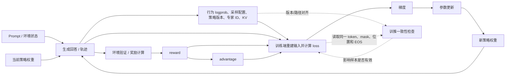

# 第 10 章训练系统：数据关系与流程总览

> 本文根据《10-训练系统.md》整理，重点回答两个问题：
>
> 1. 输入、参数状态、优化器状态、优化控制状态、前向激活、梯度和临时缓冲之间是什么关系？
> 2. 本章涉及的训练、并行、输入、checkpoint、故障恢复和 RL 流程分别经过哪些阶段，产生和依赖哪些数据？
>
> 文中的“数据”不仅指参与矩阵运算的张量，也包括决定数据如何产生、移动、保存和恢复的控制信息。

## 1-4. 核心关系与训练步摘要

原来的第 1—4 小节可以收敛为一条主线：**输入数据在控制平面的调度下进入前向，前向产生激活和损失，反向产生梯度，梯度在更新前完成累积与通信，优化器结合参数状态和优化控制状态生成下一步权重。**

| 数据层 | 典型数据 | 在训练步中的职责 | 生命周期 |
|---|---|---|---|
| 数据平面 | 输入 token、mask、位置、标签、logits、loss、前向激活、`dX`、`dW`、梯度桶、RL 轨迹、reward、advantage | 承载当前样本的计算结果和中间依赖 | 通常限于一个 micro-batch、一个训练步或一轮 RL 样本 |
| 更新状态 | BF16 权重、FP32 主权重、Adam 一阶矩、二阶矩 | 表示当前模型，并保存跨步更新所需的数值历史 | 跨训练步保留；checkpoint 需要保存 |
| 控制平面 | step、学习率、loss scale、裁剪规则、RNG、数据位置、并行布局、分片归属、通信配置、policy version、checkpoint 状态 | 决定算什么、何时计算、如何通信、是否更新以及如何恢复 | 视调度、恢复和一致性需要跨步或跨角色保留 |

其中，**前向激活服务于反向，梯度服务于参数更新，优化器状态服务于下一步更新，控制状态决定这些工作如何发生**。完整的数据类型、所在步骤以及箭头上的具体工作统一放在本文最后的集成图中。
## 1.1 数据类型与流程节点索引（点击节点可聚焦集成图）

> 在 VS Code Markdown Preview 中点击“图中节点”列的关键词：页面会滚动到第 13 节集成图，并将对应节点放大、居中。该交互由同目录的 `vscode-preview-extension/preview.js` 提供。

| 类别 | 节点关键词 | 数据/状态 | 所在步骤 | 主要工作与依赖 | 驻留位置与时间 | 图中节点 |
|---|---|---|---|---|---|---|
| 数据平面 | RAW | 原始样本 | 样本准备 | 从存储读取文本、prompt 或 RL 轨迹，交给预处理。 | 存储系统 → CPU 内存；直到完成解码/打包。 | <a class="training-focus-link" data-focus-node="RAW" href="#training-integrated-graph">RAW</a> |
| 数据平面 | IN | 输入张量 | 输入搬运、前向 | 承载 token、mask、位置和标签，驱动当前 micro-batch。 | GPU 显存；通常存活到本次前向/反向结束。 | <a class="training-focus-link" data-focus-node="IN" href="#training-integrated-graph">IN</a> |
| 数据平面 | BUF | 预取与 DMA 缓冲 | 样本准备、输入搬运 | 吸收 CPU 与 GPU 速度差，并为异步 H2D 提供源/目标缓冲。 | 锁页主机内存 + GPU 目标缓冲；DMA 完成后释放或复用。 | <a class="training-focus-link" data-focus-node="BUF" href="#training-integrated-graph">BUF</a> |
| 数据平面 | PARAMBUF | 参数临时工作区 | 前向、反向 | AllGather、格式转换并暂存当前模块所需的完整参数。 | GPU 临时显存；模块完成后可释放。 | <a class="training-focus-link" data-focus-node="PARAMBUF" href="#training-integrated-graph">PARAMBUF</a> |
| 数据平面 | ACT | 前向激活 | 前向 → 反向 | 保存反向所需中间值，或保存重计算依据/卸载副本。 | GPU 显存，必要时 CPU 内存；反向使用后释放、卸载或复用。 | <a class="training-focus-link" data-focus-node="ACT" href="#training-integrated-graph">ACT</a> |
| 数据平面 | LOGIT | logits / logprob | 前向 → 损失计算 | 产生预测值或当前策略 logprob，供标签对齐或 RL 概率比计算。 | GPU 显存；完成损失计算后可释放。 | <a class="training-focus-link" data-focus-node="LOGIT" href="#training-integrated-graph">LOGIT</a> |
| 数据平面 | LOSS | loss | 损失计算 → 反向 | 按有效 token 归一化，并把上游梯度送入反向。 | GPU 标量/小张量；反向启动后即可被消费。 | <a class="training-focus-link" data-focus-node="LOSS" href="#training-integrated-graph">LOSS</a> |
| 数据平面 | GRAD | 反向结果 | 反向 → 梯度累积 | 产生输入梯度 dX 和参数梯度 dW。 | GPU 显存；被累积或装桶后释放临时副本。 | <a class="training-focus-link" data-focus-node="GRAD" href="#training-integrated-graph">GRAD</a> |
| 数据平面 | ACC | 梯度累积 | 梯度累积 | 把多个 micro-batch 的梯度相加，并累计有效 token 分母。 | GPU/CPU 累积缓冲；直到一个 global batch 更新完成。 | <a class="training-focus-link" data-focus-node="ACC" href="#training-integrated-graph">ACC</a> |
| 数据平面 | BUCKET | 梯度桶 | 梯度累积 → 梯度通信 | 按参数分组装桶，使通信与后续反向计算重叠。 | GPU/网络通信缓冲；归约完成后释放或复用。 | <a class="training-focus-link" data-focus-node="BUCKET" href="#training-integrated-graph">BUCKET</a> |
| 数据平面 | REDUCE | 归约后梯度 | 梯度通信 → 更新前检查 | 完成 AllReduce/ReduceScatter，形成完整贡献或本卡分片。 | GPU 分片缓冲；检查和更新完成后清理。 | <a class="training-focus-link" data-focus-node="REDUCE" href="#training-integrated-graph">REDUCE</a> |
| 数据平面 | RLTRAJ | RL 轨迹 | RL 生成、输入重建 | 保存回答 token、EOS、行为 logprob、生成进度等可训练轨迹。 | 生成缓存/样本队列/存储；直到验证与训练端消费。 | <a class="training-focus-link" data-focus-node="RLTRAJ" href="#training-integrated-graph">RLTRAJ</a> |
| 数据平面 | RLSTAT | RL 统计 | 环境验证 → 损失计算 | 记录 reward、advantage、验证结果，为策略损失提供权重和方向。 | CPU/GPU 样本缓冲；对应 RL 批次训练完成后失效。 | <a class="training-focus-link" data-focus-node="RLSTAT" href="#training-integrated-graph">RLSTAT</a> |
| 数据平面 | ROUTE | 路由与版本记录 | RL 生成、反向一致性检查 | 保存 policy version、expert ID、sampling config，校验训推一致性。 | 样本元数据/控制服务；轨迹有效期内保留。 | <a class="training-focus-link" data-focus-node="ROUTE" href="#training-integrated-graph">ROUTE</a> |
| 训练步骤 | PREP | 样本准备 | 第 1 步 | 读取、解码、分词、筛选、拼接并打包 batch。 | CPU/存储；与 GPU 计算并行。 | <a class="training-focus-link" data-focus-node="PREP" href="#training-integrated-graph">PREP</a> |
| 训练步骤 | H2D | 输入搬运 | 第 2 步 | 通过预取、DMA 和 H2D 把输入送入 GPU。 | PCIe/NVLink + GPU；直到输入可被计算读取。 | <a class="training-focus-link" data-focus-node="H2D" href="#training-integrated-graph">H2D</a> |
| 训练步骤 | FWD | 前向计算 | 第 3 步 | 读取权重和输入，产生激活与 logits。 | GPU 计算流；受调度、重计算和卸载策略约束。 | <a class="training-focus-link" data-focus-node="FWD" href="#training-integrated-graph">FWD</a> |
| 训练步骤 | LC | 损失计算 | 第 4 步 | 将 logits 与标签对齐，按有效 token 计算/归一化 loss。 | GPU；loss 交给反向后结束。 | <a class="training-focus-link" data-focus-node="LC" href="#training-integrated-graph">LC</a> |
| 训练步骤 | BWD | 反向传播 | 第 5 步 | 按依赖读取激活，传播 dX 并计算 dW。 | GPU 计算流；依赖激活有效且路由/版本一致。 | <a class="training-focus-link" data-focus-node="BWD" href="#training-integrated-graph">BWD</a> |
| 训练步骤 | GA | 梯度累积 | 第 6 步 | 合并 micro-batch 梯度，统一有效 token 分母。 | GPU/CPU 累积缓冲；到更新边界才提交。 | <a class="training-focus-link" data-focus-node="GA" href="#training-integrated-graph">GA</a> |
| 训练步骤 | COMM | 梯度通信 | 第 7 步 | 执行装桶、AllReduce 或 ReduceScatter，汇总跨设备贡献。 | GPU + 网络 + PCIe/NVLink；通信完成后形成可更新梯度。 | <a class="training-focus-link" data-focus-node="COMM" href="#training-integrated-graph">COMM</a> |
| 训练步骤 | CHECK | 更新前检查 | 第 8 步 | 计算范数、检查溢出、裁剪并决定是否跳过本步更新。 | GPU/CPU；消费本步梯度，受优化规则控制。 | <a class="training-focus-link" data-focus-node="CHECK" href="#training-integrated-graph">CHECK</a> |
| 训练步骤 | OPT | 优化器更新 | 第 9 步 | 结合梯度、主权重、Adam 状态和学习率生成更新后的状态。 | GPU/CPU 优化器工作区；更新跨步状态。 | <a class="training-focus-link" data-focus-node="OPT" href="#training-integrated-graph">OPT</a> |
| 训练步骤 | CAST | 权重写回 | 第 10 步 | 将 FP32 主权重转换/同步为 BF16，并按分片写回。 | GPU/通信缓冲；形成下一步可读权重。 | <a class="training-focus-link" data-focus-node="CAST" href="#training-integrated-graph">CAST</a> |
| 训练步骤 | NEXT | 进入下一步 | 第 11 步 | 释放临时数据、复用缓冲并推进下一轮输入。 | 训练步边界；决定短生命周期数据何时离开。 | <a class="training-focus-link" data-focus-node="NEXT" href="#training-integrated-graph">NEXT</a> |
| 更新状态 | WBF | BF16 模型权重 | 前向、反向 | 作为计算精度权重被读取，并在写回后替换为下一步版本。 | GPU/分片存储；跨训练步保留，需可 checkpoint。 | <a class="training-focus-link" data-focus-node="WBF" href="#training-integrated-graph">WBF</a> |
| 更新状态 | WFP | FP32 主权重 | 优化器更新 | 作为高精度更新载体，避免直接在 BF16 上累积误差。 | GPU/CPU；跨训练步保留。 | <a class="training-focus-link" data-focus-node="WFP" href="#training-integrated-graph">WFP</a> |
| 更新状态 | MOM1 | Adam 一阶矩 m | 优化器更新 | 保存梯度的一阶历史，参与下一次参数更新。 | GPU/CPU；跨训练步保留并写入 checkpoint。 | <a class="training-focus-link" data-focus-node="MOM1" href="#training-integrated-graph">MOM1</a> |
| 更新状态 | MOM2 | Adam 二阶矩 v | 优化器更新 | 保存梯度平方的二阶历史，参与自适应步长计算。 | GPU/CPU；跨训练步保留并写入 checkpoint。 | <a class="training-focus-link" data-focus-node="MOM2" href="#training-integrated-graph">MOM2</a> |
| 更新状态 | WNEW | 下一步 BF16 权重 | 权重写回 → 下一步 | 承接当前更新结果，成为下一步前向/反向使用的权重。 | GPU/分片存储；跨步保留。 | <a class="training-focus-link" data-focus-node="WNEW" href="#training-integrated-graph">WNEW</a> |
| 更新状态 | CKDATA | Checkpoint 快照 | 快照、恢复 | 聚合权重、主权重、Adam 状态及控制/进度元数据，形成可恢复版本。 | CPU/快照缓冲/存储；提交完成前必须保持一致。 | <a class="training-focus-link" data-focus-node="CKDATA" href="#training-integrated-graph">CKDATA</a> |
| 控制平面 | CURSOR | 数据进度 | 样本准备、恢复 | 记录 sampler、batch 位置和打包器剩余 token，避免跳过或重复数据。 | CPU/控制存储；跨步和 checkpoint 保留。 | <a class="training-focus-link" data-focus-node="CURSOR" href="#training-integrated-graph">CURSOR</a> |
| 控制平面 | STEP | step 与 micro-batch 计数 | 梯度累积、优化器更新 | 决定累积边界、更新时机并推进全局训练步。 | 控制状态；跨步保留。 | <a class="training-focus-link" data-focus-node="STEP" href="#training-integrated-graph">STEP</a> |
| 控制平面 | RNG | RNG 状态 | 样本准备、前向/反向、恢复 | 控制采样、dropout、数据顺序及可重放性。 | CPU/GPU/控制存储；跨步和 checkpoint 保留。 | <a class="training-focus-link" data-focus-node="RNG" href="#training-integrated-graph">RNG</a> |
| 控制平面 | RULE | 优化规则 | 更新前检查、优化器更新 | 提供学习率、loss scale、裁剪阈值、权重衰减等规则。 | 控制状态；通常跨步保留。 | <a class="training-focus-link" data-focus-node="RULE" href="#training-integrated-graph">RULE</a> |
| 控制平面 | PAR | 并行与分片布局 | 参数收集、梯度通信、恢复 | 决定 DP/TP/PP/EP、分片归属和通信组。 | 运行时配置/元数据；跨 checkpoint 保留。 | <a class="training-focus-link" data-focus-node="PAR" href="#training-integrated-graph">PAR</a> |
| 控制平面 | SCHED | 调度与通信配置 | 前向、梯度通信 | 决定流水线、桶大小、重计算、卸载和通信重叠。 | 运行时控制状态；可按实验配置跨步保持。 | <a class="training-focus-link" data-focus-node="SCHED" href="#training-integrated-graph">SCHED</a> |
| 控制平面 | VERSION | 版本控制 | 检查、写回、提交 | 匹配权重、样本、policy 和 checkpoint，防止不同进度混用。 | 控制元数据；跨角色/跨 checkpoint 保留。 | <a class="training-focus-link" data-focus-node="VERSION" href="#training-integrated-graph">VERSION</a> |
| 控制平面 | RECOVER | 恢复控制 | 故障恢复 | 选择一致快照，并恢复权重、优化器、数据位置和 RNG。 | 恢复流程状态；直到恢复完成。 | <a class="training-focus-link" data-focus-node="RECOVER" href="#training-integrated-graph">RECOVER</a> |

## 5. micro-batch、流水线与激活生命周期

### 5.1 micro-batch 累积流程

| 时间顺序 | 操作 | 梯度状态 | 参数状态 | 说明 |
|---|---|---|---|---|
| `k=1...m` | 对第 `k` 个 micro-batch 执行前向和反向 | 将 `dW_k` 加到累积梯度 | 仍使用同一份当前权重 | 不能在每个 micro-batch 后更新，否则改变后续 micro-batch 的目标参数 |
| 累积期间 | 继续产生并保存/归约梯度 | 梯度和持续增长；分母为全局有效 token 数 | 权重不变 | 梯度通信可以与后续计算重叠 |
| `k=m` 完成后 | 梯度裁剪、溢出检查 | 获得全局 batch 梯度 | 权重仍未更新 | 裁剪和归一化只做一次 |
| 更新阶段 | Adam/AdamW 更新 | 梯度被消费并清零或复用 | 主权重、矩状态和 BF16 权重更新 | 形成下一训练步的状态 |

### 5.2 流水调度对驻留数据的影响

| 调度 | 前向/反向顺序 | 激活驻留特征 | 时间特征 | 适用取舍 |
|---|---|---|---|---|
| 填满排空 | 先让多个 micro-batch 完成前向，再集中反向 | 等待反向的激活多，峰值通常随 micro-batch 数增加 | 结构简单，但填充和排空气泡明显 | 显存充足、实现简单时 |
| 1F1B | 预热后交替执行一个前向和一个反向 | 较早释放激活，峰值降低 | 通常能改善驻留，但要处理前后向依赖和传输空隙 | 激活是容量瓶颈时 |
| 交错式 1F1B | 将阶段切成更多虚拟块 | 降低气泡，但跨边界传输次数增加 | 可能更快，也可能被通信启动和链路争用抵消 | 通信资源足够且气泡占比仍高时 |
| Zero-Bubble | 将 `dX` 和 `dW` 拆开，尽早传递 `dX`，延后 `dW` | `dW` 延后可能使部分梯度或激活驻留更久 | 可把 `dW` 填进气泡，减少空闲 | 需要同时满足关键路径和显存约束 |
| DualPipe 等重叠调度 | 重叠不同方向或角色的工作 | 依赖更多并发缓冲和状态 | 可能减少空闲，但参数/缓冲复杂度增加 | 要结合容量和通信拓扑评估 |

### 5.3 激活、重计算和卸载的关系

| 方法 | 保留什么 | 释放什么 | 新增代价 | 何时收益最大 |
|---|---|---|---|---|
| 完整保存 | 保存反向所需的中间值 | 反向完成后释放 | 显存占用高 | 计算紧张、显存充足 |
| 选择性重计算 | 只保留重建所需的较小输入或检查点 | 释放可由它们重建的中间结果 | 重新执行部分前向算子 | 激活多、重算计算量相对可接受 |
| CPU/GPU 卸载 | 把暂时不用的激活或状态移到主机 | GPU 上的副本可释放，但 DMA 源仍需保留 | 传输、目标缓冲和链路争用 | 主机内存充足、传输能被计算隐藏 |
| 参数分片 | 每卡只保存自己的权重/梯度/优化器分片 | 释放重复副本 | AllGather、ReduceScatter | 模型状态复制是主要显存来源 |
| 参数收集临时缓冲 | 模块执行前收集完整参数 | 模块完成后释放完整副本 | 临时峰值和通信 | 常驻参数已分片但模块执行仍需完整权重 |

## 6. 分片、并行与通信流程

### 6.1 ZeRO/FSDP 各阶段保存什么

| 配置 | 每卡长期保存 | 每卡仍复制的内容 | 执行时新增临时数据 | 主要通信 |
|---|---|---|---|---|
| 普通数据并行 | 完整 BF16 权重、梯度、主权重、Adam 状态 | 全部训练状态 | 常规前向/反向缓冲 | 梯度 AllReduce |
| ZeRO-1 | 完整权重和梯度；主权重与 Adam 状态分片 | 权重、梯度 | 更新所需的本地分片 | 更新状态相关通信 |
| ZeRO-2 | 完整 BF16 权重；梯度、主权重、Adam 状态分片 | 权重 | 梯度分片和通信缓冲 | ReduceScatter 等 |
| ZeRO-3/FSDP | 权重、梯度、主权重、Adam 状态均分片 | 无完整训练状态长期副本 | 模块执行前的完整参数缓冲 | 前向/反向前 AllGather，反向后 ReduceScatter |

### 6.2 一个分片模块的执行顺序

| 顺序 | 动作 | 产生/移动的数据 | 生命周期 |
|---|---|---|---|
| 1 | 本卡持有参数分片 | 本地长期权重分片 | 跨步保留 |
| 2 | AllGather | 完整模块权重 | 从收集开始占用临时空间，模块完成后可释放 |
| 3 | 前向或反向 | 激活、输出、梯度 | 由对应计算依赖决定 |
| 4 | ReduceScatter | 参数梯度贡献被归约并重新分片 | 通信完成后释放通信桶，保留本卡负责的梯度分片 |
| 5 | 本地更新 | 本卡负责的主权重、Adam 状态和梯度分片 | 更新后形成新的本地分片 |
| 6 | 下一模块预取 | 下一模块的完整参数 | 可与当前计算重叠；是否成功取决于链路带宽和计算窗口 |

### 6.3 通信桶与计算重叠

| 对象 | 何时就绪 | 可以与什么重叠 | 不能隐藏时的后果 |
|---|---|---|---|
| 小梯度桶 | 桶内梯度全部产生后 | 后续反向计算、其他独立计算 | 启动次数增加，但可以更早发送 |
| 大梯度桶 | 更多梯度产生后 | 较少启动开销 | 更可能等待最后一个梯度，通信开始晚 |
| 参数 AllGather | 当前模块即将执行或预取窗口开始 | 前一模块计算 | 若来不及，当前模块等待参数 |
| ReduceScatter | 当前模块反向产生参数梯度后 | 后续反向计算或其他通信 | 若链路被占用，通信尾部延伸到计算结束之后 |
| 专家交换 | token dispatch 或反向输入梯度就绪后 | 专家计算、其他通信 | 与梯度归约争用链路，导致尾部等待 |

## 7. 输入、预取和数据进度流程

| 阶段 | 数据 | 位置 | 与计算的关系 | 恢复时必须知道什么 |
|---|---|---|---|---|
| 读取 | 原始样本 | 存储系统 | 受存储吞吐影响 | 数据集版本、读取位置或可重放的 sampler 状态 |
| 解码/分词 | token 候选 | CPU 内存 | CPU 准备速度可能成为瓶颈 | 随机状态、处理配置 |
| 筛选/拼接 | 有效 token、序列边界 | CPU 内存 | 决定实际序列长度和有效 token 数 | 已使用数据位置、筛选规则 |
| 打包 | 目标长度序列、mask、标签 | CPU 缓冲 | 影响注意力关系、损失权重和后续样本 | 打包器中尚未组成完整序列的 token |
| 预取 | 已安排但未训练的 batch | CPU 队列/锁页内存 | 与 GPU 计算并行，吸收速度波动 | 预取进度与实际训练进度之间的差额 |
| H2D 搬运 | GPU 输入张量 | PCIe/NVLink + GPU | 可以异步，但 DMA 期间源缓冲不能释放 | 正在传输的 batch 是否已完成 |
| 消费 | 已用于前向/反向的 batch | GPU | 推进训练进度 | 最后一个已完成的 batch 位置 |

**恢复规则：** 如果预取已经安排到 batch 108，但训练只完成到 batch 100，恢复时不能简单从 batch 109 开始；batch 101–108 是已准备但尚未训练的数据，要么保留并继续消费，要么重新准备，训练进度应从 batch 101 继续。

## 8. checkpoint、异步保存与故障恢复流程

### 8.1 可恢复状态清单

| 状态类别 | 需要保存的内容 | 不保存的后果 |
|---|---|---|
| 模型参数 | BF16 权重、必要时 FP32 主权重 | 无法从同一参数继续 |
| 优化器历史 | Adam 一阶矩、二阶矩 | 下一次更新不同，即使权重相同也不能严格续训 |
| 优化控制 | step、学习率状态、损失缩放/更新规则 | 更新幅度、是否跳过更新可能不同 |
| 随机性 | RNG 状态 | 后续随机采样、dropout 或数据顺序不同 |
| 数据进度 | sampler 位置、已完成 batch、打包器剩余 token | 下一条序列或标签不同，可能跳过或重复数据 |
| 分布式布局 | 分片方式、rank/布局映射、版本信息 | 无法正确重分片或把状态放回目标卡 |
| 提交元数据 | 文件完整性、提交标志、最新有效版本 | 可能误用尚未写完的快照 |

### 8.2 同步与异步保存

| 阶段 | 同步保存 | 异步保存 | 必须满足的条件 |
|---|---|---|---|
| 捕获状态 | 固定当前一致状态 | 固定当前一致状态 | 快照中的数据和控制状态必须属于同一训练进度 |
| 复制 | 训练暂停并直接写出 | 复制到独立快照缓冲 | 复制期间源状态不能被不一致地修改 |
| 后台写入 | 无独立后台阶段或训练等待 | 后台写入存储 | 快照缓冲在写完前必须保留 |
| 提交 | 写完后可用 | 写完并提交元数据后可用 | 只有完整提交的 checkpoint 可恢复 |
| 故障恢复 | 通常使用最近一次已写完快照 | 可能回退到最近一次已提交快照 | 不能把“已开始写”当成“可恢复” |

### 8.3 checkpoint 相关流程和信息

| 流程 | 输入 | 输出 | 生命周期/时间约束 | 关键指标 |
|---|---|---|---|---|
| 捕获 | 当前权重、主权重、Adam 状态、控制状态、数据进度 | 一致快照 | 捕获期间需定义训练是否暂停或如何隔离 | 前台暂停时间 |
| 缓冲 | 一致快照 | 独立快照副本 | 异步写入完成前不能复用 | 快照缓冲大小 |
| 写入 | 快照副本 | checkpoint 文件 | 写入速率必须不低于长期产生速率，否则积压 | 存储带宽、排队深度 |
| 提交 | 文件和元数据 | 可恢复版本指针 | 提交前故障只能使用上一版本 | 提交延迟、完整性 |
| 恢复 | 最近有效 checkpoint | GPU/CPU 上可运行的训练状态 | 可能需要重分片、重新加载输入或重建 KV | 恢复时间、重做训练量 |
| 回滚 | 发现硬件故障、损失尖峰或状态无效 | 丢弃未提交进度 | 平均丢失最近保存间隔的一部分工作 | 回滚比例、有效训练时间 |

## 9. RL 训练：从固定数据流变成反馈闭环

### 9.1 RL 反馈循环图

这张图的核心读法是：**数据平面负责“算出什么”，更新状态负责“模型变成什么”，控制平面负责“何时、按什么规则、在什么分片和版本下去算”。**

### 9.2 RL 一轮流程表

| 阶段 | 输入 | 产物 | 后续使用者 | 必须保留的信息 |
|---|---|---|---|---|
| 1. 采样提示 | prompt、环境状态、当前策略版本 | prompt batch | 生成端 | 样本 ID、策略版本 |
| 2. 生成回答 | prompt、策略权重、采样配置 | 回答 token、终止状态、轨迹 | 验证器和训练端 | token 顺序、EOS/截断位置、采样配置 |
| 3. 记录行为 | 生成过程 | behavior logprob、专家选择、KV、生成进度 | 训练端和恢复流程 | 生成时使用的策略版本和实际采样概率 |
| 4. 环境验证 | 轨迹、任务规则 | reward、验证结果 | 优势计算 | 轨迹与奖励的样本 ID 对齐 |
| 5. 计算优势 | reward、基准或组内统计 | advantage | 策略损失 | 组关系、归一化规则 |
| 6. 重建训练输入 | 轨迹 token、模板、位置、mask、EOS | 训练端输入 | 前向和 loss | tokenizer、对话模板、位置编号和 mask |
| 7. 计算概率比/loss | 当前策略 logprob、行为 logprob、advantage | 策略损失 | 反向 | 行为分布覆盖、版本差异、裁剪规则 |
| 8. 参数更新 | 梯度、优化器状态 | 新策略权重 | 下一轮生成 | step、学习率、优化器历史 |
| 9. 权重同步 | 新策略权重 | 生成端可用的新版本 | 下一轮采样 | 权重版本和生效时刻 |

### 9.3 RL 中容易被忽略的数据关系

| 数据 | 为什么需要 | 什么时候失效 |
|---|---|---|
| reward | 决定样本是否有学习信号以及方向 | 奖励相同导致优势为零时，策略梯度可能为零；参数仍可能因权重衰减改变 |
| advantage | 决定每个回答对梯度的权重和方向 | 组内基准或归一化规则改变时需要重新计算 |
| behavior logprob | 与当前策略 logprob 构成概率比，用于重要性加权或 PPO 裁剪 | 丢失后无法严格计算已采样行为相对当前策略的权重 |
| sampling config | 温度、top-k/top-p 等改变实际行为分布 | 只保存原始 logits 而不保存采样规则时，无法重建行为概率 |
| policy version | 判断轨迹是否过期、是否需要丢弃或降权 | 版本差距超过系统允许范围时样本可能无效 |
| KV cache | 相同权重下可继续生成前缀 | 权重改变后旧 KV 不再对应当前策略，需要 prefill 重建 |
| expert ID | 固定离散路由，减少生成端和训练端的专家选择差异 | token 位置、层号或样本 ID 对不上时无法正确重放 |
| 轨迹生成进度 | 中断后继续长轨迹，而不是整条丢弃 | 进度、策略版本或 KV 不可恢复时只能重新采样 |

### 9.4 同步与异步 RL 流程

| 方案 | 阶段顺序 | 优点 | 新增风险 | 评价指标 |
|---|---|---|---|---|
| 同步 | 生成 → 学习 → 权重同步 → 下一轮生成 | 样本版本清晰、实现简单 | 生成端和学习端互相等待 | 单轮时间、有效样本吞吐 |
| 异步 | 生成下一批与学习上一批并行，完成后同步权重 | 减少两侧空等，提高设备利用率 | 样本可能来自旧策略，过期样本要丢弃或降权 | 周期、保留率、有效样本吞吐、奖励 |
| 异步恢复 | 保存未完成轨迹的 token 进度、策略版本和可复用 KV | 减少长轨迹因中断而全部重采样 | 状态保存和取回增加存储/传输成本 | 完成轨迹比例、恢复时间、版本滞后 |

## 10. “流程—数据—资源—正确性”总览表

| 流程 | 主要数据 | 主要资源 | 主要正确性条件 | 典型瓶颈 |
|---|---|---|---|---|
| 输入准备 | 原始样本、token、mask、预取队列 | CPU、存储、主机内存、PCIe | 数据顺序、打包、mask 和读取位置正确 | CPU 准备速度、存储吞吐 |
| 前向 | 权重、输入、激活、参数收集缓冲 | GPU 计算、显存、集合通信 | 使用同一版本权重和正确的分片 | 激活峰值、AllGather |
| 反向 | 激活、上游梯度、参数梯度 | GPU 计算、显存、通信链路 | 激活在使用前有效，`dX`/`dW` 依赖不被破坏 | 激活驻留、反向关键路径 |
| 梯度累积 | 多 micro-batch 梯度、有效 token 分母 | GPU/CPU 缓冲 | 所有 token 按统一分母贡献 | 累积状态容量、梯度归一化 |
| 梯度归约 | 梯度桶、分片归属 | GPU、网络、PCIe/NVLink | 所有贡献都被归约且桶不丢失 | 链路争用、桶过大/过小 |
| 参数更新 | 梯度、主权重、Adam 矩、控制状态 | GPU/CPU 内存、优化器计算 | step、学习率、权重衰减和溢出规则一致 | 优化器状态容量、CPU/GPU 传输 |
| checkpoint | 训练状态、数据进度、提交元数据 | CPU 缓冲、存储、后台写线程 | 快照一致且提交完成 | 写带宽、暂停、恢复延迟 |
| 故障恢复 | 最近有效快照、布局映射 | 存储、CPU/GPU 初始化、通信 | 参数、优化器、数据和 RNG 同一进度 | 重分片、重做工作 |
| RL 生成 | 策略权重、prompt、采样配置、KV | 生成 GPU、缓存、环境 | 行为概率和版本可追踪 | 生成速度、长轨迹、中断 |
| RL 学习 | 轨迹、reward、advantage、behavior logprob | 训练 GPU、样本队列 | 训练端与生成端 token/概率/路由可对齐 | 版本滞后、有效样本率 |

## 11. 设计决策的顺序

本章的各种技术不是可以任意叠加的开关，建议按下面顺序判断：

| 决策顺序 | 要回答的问题 | 相关数据 | 如果不满足 |
|---:|---|---|---|
| 1 | 常驻训练状态能否放下？ | 权重、主权重、Adam 矩、梯度分片 | 先用 ZeRO/FSDP、增加卡数或卸载 |
| 2 | 运行峰值能否放下？ | 激活、完整参数缓冲、通信桶、工作区 | 减少同时驻留、重计算、改变调度 |
| 3 | 数据能否及时到达？ | AllGather、ReduceScatter、H2D、DMA、预取数据 | 预取、通信重叠或更换互联 |
| 4 | 梯度能否在更新前完整汇总？ | micro-batch 梯度、梯度桶、有效 token 分母 | 调整累积和通信桶，不能提前更新 |
| 5 | checkpoint 能否持续写完？ | 快照、后台缓冲、提交元数据 | 降低保存频率、提高写带宽或增大缓冲 |
| 6 | 故障后能否从同一进度继续？ | 权重、优化器、step、RNG、数据位置 | 只能近似恢复或重复/跳过数据 |
| 7 | RL 样本是否仍然有效？ | policy version、behavior logprob、reward、路由记录 | 丢弃、降权、重新采样或重放 |
| 8 | 方案是否真的更快？ | 每步时间、气泡、通信等待、有效样本吞吐、恢复开销 | 不能只看单一 MFU 或峰值显存 |

## 12. 一句话总结

**输入决定本轮算什么，参数状态决定模型当前是什么，前向激活保存“如何反向”，梯度记录“本轮应怎样改变参数”，优化器状态记录“过去的梯度历史如何影响改变”，优化控制状态决定“何时、按什么规则以及用哪一批数据改变”，而 checkpoint、并行元数据和 RL 版本/路由记录保证这些数据在不同设备、不同时间和不同角色之间仍然对应同一个训练进度。**
## 13. 1—4 小节集成关系图：数据类型、所在步骤与数据工作

<a class="training-reset-link" href="#training-integrated-graph" data-focus-node="__RESET__">↺ 重置图形视图</a>

下图把数据平面、更新状态和控制平面放在同一条训练主线上。主线箭头上的文字表示数据在相邻步骤之间完成的工作；虚线表示控制信息对计算、通信、更新或恢复的约束。

```mermaid
flowchart LR
    %% =========================
    %% 数据平面
    %% =========================
    subgraph DP[数据平面：当前样本与中间结果]
        RAW[原始样本<br/>prompt、文本、轨迹]
        IN[输入张量<br/>token、mask、位置、标签]
        BUF[预取与 DMA 缓冲<br/>锁页主机缓冲、GPU 目标缓冲]
        PARAMBUF[参数临时工作区<br/>AllGather、格式转换、分片缓存]
        ACT[前向激活<br/>中间值、cache、重计算依据]
        LOGIT[logits / logprob]
        LOSS[loss<br/>按有效 token 归一化]
        GRAD[反向结果<br/>dX、dW]
        ACC[梯度累积<br/>梯度和、有效 token 分母]
        BUCKET[梯度桶<br/>通信缓冲、分片梯度]
        REDUCE[归约后梯度<br/>完整贡献或本卡分片]
        RLTRAJ[RL 轨迹<br/>回答 token、EOS、行为 logprob]
        RLSTAT[RL 统计<br/>reward、advantage、验证结果]
        ROUTE[路由与版本记录<br/>policy version、expert ID、sampling config]
    end

    %% =========================
    %% 训练步骤
    %% =========================
    subgraph ST[训练步骤：数据经过的工作]
        PREP[1. 样本准备<br/>读取、解码、分词、筛选、打包]
        H2D[2. 输入搬运<br/>预取、DMA、H2D]
        FWD[3. 前向计算<br/>读取权重并产生中间结果]
        LC[4. 损失计算<br/>logits 与标签对齐、归一化]
        BWD[5. 反向传播<br/>按依赖读取激活并计算梯度]
        GA[6. 梯度累积<br/>合并 micro-batch 贡献]
        COMM[7. 梯度通信<br/>装桶、AllReduce、ReduceScatter]
        CHECK[8. 更新前检查<br/>裁剪、溢出检查、决定是否跳步]
        OPT[9. 优化器更新<br/>应用学习率和权重更新规则]
        CAST[10. 权重写回<br/>主权重转为 BF16 并同步分片]
        NEXT[11. 进入下一步<br/>释放临时数据、复用缓冲]
    end

    %% =========================
    %% 更新状态
    %% =========================
    subgraph US[更新状态：跨步保留的数值状态]
        WBF[BF16 模型权重<br/>前向和反向读取]
        WFP[FP32 主权重<br/>高精度更新载体]
        MOM1[Adam 一阶矩 m]
        MOM2[Adam 二阶矩 v]
        WNEW[下一步 BF16 权重]
        CKDATA[Checkpoint 快照<br/>权重、主权重、m、v]
    end

    %% =========================
    %% 控制平面
    %% =========================
    subgraph CP[控制平面：决定何时、如何以及是否执行]
        CURSOR[数据进度<br/>sampler、batch、打包器剩余 token]
        STEP[step 与 micro-batch 计数]
        RNG[RNG 状态<br/>采样、dropout、数据顺序]
        RULE[优化规则<br/>学习率、loss scale、裁剪阈值、权重衰减]
        PAR[并行与分片布局<br/>DP、TP、PP、EP、分片归属]
        SCHED[调度与通信配置<br/>流水线、桶大小、重计算、卸载]
        VERSION[版本控制<br/>policy version、checkpoint 提交状态]
        RECOVER[恢复控制<br/>快照选择、重分片、恢复位置]
    end

    %% =========================
    %% 监督训练主线：每条箭头都标出数据工作
    %% =========================
    RAW -->|读取、解码、分词、筛选、打包| PREP
    PREP -->|写入预取和锁页缓冲| BUF
    BUF -->|以 DMA 搬运到 GPU| H2D
    H2D -->|交付 GPU 输入张量| IN
    IN -->|启动当前模块前向| FWD
    WBF -->|按分片提供本地权重| PARAMBUF
    PARAMBUF -->|AllGather 后供当前模块读取| FWD
    FWD -->|保存或标记可重计算的中间结果| ACT
    FWD -->|产生预测值| LOGIT
    LOGIT -->|与标签对齐并计算有效 token loss| LC
    LC -->|产生归一化损失| LOSS
    LOSS -->|把损失梯度传入反向| BWD
    ACT -->|按反向顺序读取，或重计算后读取| BWD
    BWD -->|传播输入梯度并产生参数梯度| GRAD
    GRAD -->|按 micro-batch 相加并累计分母| GA
    GA -->|按参数分组装入通信缓冲| BUCKET
    BUCKET -->|跨设备归约并按分片分配| COMM
    COMM -->|得到可用于本次更新的梯度| REDUCE
    REDUCE -->|计算范数、检查溢出并裁剪| CHECK
    CHECK -->|通过检查则提交有效梯度| OPT
    WFP -->|提供高精度参数| OPT
    MOM1 -->|提供一阶历史| OPT
    MOM2 -->|提供二阶历史| OPT
    OPT -->|更新主权重和优化器历史| WFP
    OPT -->|更新一阶矩| MOM1
    OPT -->|更新二阶矩| MOM2
    WFP -->|格式转换、同步和分片写回| CAST
    CAST -->|生成下一步可读权重| WNEW
    WNEW -->|替换当前模型权重| WBF
    NEXT -->|开始下一轮输入和前向| PREP

    %% =========================
    %% 控制平面对工作步骤的约束
    %% =========================
    CURSOR -.->|确定下一批数据和恢复位置| PREP
    RNG -.->|决定随机采样、dropout 和数据顺序| PREP
    RNG -.->|提供前向/反向随机状态| FWD
    STEP -.->|决定 micro-batch 累积边界和更新时机| GA
    STEP -.->|推进全局训练步| OPT
    RULE -.->|提供学习率、loss scale 和裁剪规则| CHECK
    RULE -.->|提供权重衰减和更新超参数| OPT
    PAR -.->|决定参数分片、收集方式和归属| PARAMBUF
    PAR -.->|决定梯度通信组和 ReduceScatter 结果| COMM
    SCHED -.->|决定流水线、激活驻留、重计算和卸载| FWD
    SCHED -.->|决定通信桶和通信重叠| COMM
    VERSION -.->|标记当前权重、样本和快照是否匹配| CHECK
    VERSION -.->|记录更新后的策略版本| CAST

    %% =========================
    %% RL 数据接入主线
    %% =========================
    WBF -->|按当前策略生成回答| RLTRAJ
    ROUTE -->|约束采样配置、版本和专家路由| RLTRAJ
    RLTRAJ -->|交给验证器计算结果| RLSTAT
    RLSTAT -->|生成策略损失的权重和方向| LOSS
    RLTRAJ -->|重建 token、mask、位置和 EOS| IN
    ROUTE -->|检查训推 token、版本和路由一致性| BWD

    %% =========================
    %% 激活、梯度和 checkpoint 的生命周期
    %% =========================
    ACT -.->|反向完成后释放、卸载或复用| NEXT
    BUCKET -.->|通信完成后释放或复用| NEXT
    REDUCE -.->|更新完成后清理本步梯度| NEXT
    WNEW -.->|作为下一步持久模型状态| NEXT
    WFP -->|与 m、v、step 等一起形成快照| CKDATA
    WBF -->|写入当前模型权重快照| CKDATA
    STEP -->|写入训练步和累积进度| CKDATA
    CURSOR -->|写入数据读取位置| CKDATA
    RNG -->|写入随机状态| CKDATA
    PAR -->|写入并行布局和分片映射| CKDATA
    RULE -.->|保存学习率和更新规则| CKDATA
    MOM1 -->|写入可恢复优化器历史| CKDATA
    MOM2 -->|写入可恢复优化器历史| CKDATA
    CKDATA -->|提交后成为最近有效版本| VERSION
    VERSION -->|故障时选择一致快照| RECOVER
    RECOVER -->|恢复权重、优化器、数据位置和 RNG| WBF
    RECOVER -->|恢复训练进度和更新规则| STEP
    RECOVER -->|恢复样本读取位置| CURSOR
```

