# 训练系统：数据类型与工作流程总览

> 本文件是《10-训练系统.md》的简化交互版。
>
> - 表格按“数据类型 → 所在步骤 → 完成的工作 → 生命周期”组织。
> - Mermaid 图把数据平面、更新状态和控制平面放在同一条训练主线上。
> - 在支持 Mermaid `click` 的 Markdown 预览器中，点击图中节点可以跳转到表格对应条目；点击表格中的“定位图中节点”可以回到集成图。
> - 纯 Markdown/Mermaid 通常只能实现链接定位，不能保证自动缩放和居中；真正的放大居中需要额外的网页 JavaScript。

## 1. 数据类型总表

### 1.1 数据平面：当前样本和当前训练步产生的结果

| 数据类型 | 产生或维护步骤 | 主要工作 | 后续使用者 | 生命周期 | 图中节点 |
|---|---|---|---|---|---|
| 原始样本 / prompt | 样本准备 | 读取、解码、分词、筛选和打包 | 输入张量、RL 轨迹 | 进入当前 batch 后可释放或按数据集保留 | <a class="training-focus-link" data-focus-node="RAW" href="#training-integrated-graph">RAW</a> |
| 输入张量 | 输入搬运、前向 | 携带 token、mask、位置和标签 | 前向计算、损失计算 | 当前 micro-batch | <a class="training-focus-link" data-focus-node="IN" href="#training-integrated-graph">IN</a> |
| 预取与 DMA 缓冲 | 输入准备、输入搬运 | 在 CPU、PCIe/NVLink 和 GPU 之间搬运数据 | 输入张量 | DMA 完成前必须保持有效，完成后复用 | <a class="training-focus-link" data-focus-node="BUF" href="#training-integrated-graph">BUF</a> |
| 参数临时工作区 | 前向、参数收集 | 保存 AllGather 后的完整参数或格式转换结果 | 当前模块前向 | 当前模块计算期间 | <a class="training-focus-link" data-focus-node="PARAMBUF" href="#training-integrated-graph">PARAMBUF</a> |
| 前向激活 | 前向计算 | 保存反向所需的中间值，或提供重计算依据 | 反向传播 | 对应反向完成前；也可卸载、重计算 | <a class="training-focus-link" data-focus-node="ACT" href="#training-integrated-graph">ACT</a> |
| logits / logprob | 前向计算 | 形成预测结果或策略概率 | 损失计算、RL 概率比 | 当前样本的损失计算完成前 | <a class="training-focus-link" data-focus-node="LOGIT" href="#training-integrated-graph">LOGIT</a> |
| loss | 损失计算 | 按有效 token、reward 或 advantage 计算训练目标 | 反向传播 | 当前训练步 | <a class="training-focus-link" data-focus-node="LOSS" href="#training-integrated-graph">LOSS</a> |
| `dX` / `dW` | 反向传播 | 将损失影响传回输入，并计算参数梯度 | 梯度累积、梯度通信 | 当前 micro-batch，进入累积后可释放局部副本 | <a class="training-focus-link" data-focus-node="GRAD" href="#training-integrated-graph">GRAD</a> |
| 梯度累积和 | 梯度累积 | 合并多个 micro-batch 的梯度，并维护有效 token 分母 | 梯度通信、更新前检查 | 一个全局 batch 或一次更新 | <a class="training-focus-link" data-focus-node="ACC" href="#training-integrated-graph">ACC</a> |
| 梯度桶 | 梯度通信 | 按参数分组，支持通信与反向重叠 | AllReduce / ReduceScatter | 通信完成后释放或复用 | <a class="training-focus-link" data-focus-node="BUCKET" href="#training-integrated-graph">BUCKET</a> |
| 归约后梯度 | 梯度通信完成后 | 得到完整梯度贡献或本卡负责的梯度分片 | 梯度裁剪、优化器更新 | 本次参数更新 | <a class="training-focus-link" data-focus-node="REDUCE" href="#training-integrated-graph">REDUCE</a> |
| RL 轨迹 | RL 生成、验证 | 保存 prompt、回答 token、EOS、行为 logprob 和生成进度 | reward、advantage、策略损失 | 训练、重放或恢复未完成轨迹期间 | <a class="training-focus-link" data-focus-node="RLTRAJ" href="#training-integrated-graph">RLTRAJ</a> |
| reward / advantage | RL 验证、优势计算 | 决定策略损失的方向和权重 | RL loss、反向传播 | 对应轨迹完成训练前 | <a class="training-focus-link" data-focus-node="RLSTAT" href="#training-integrated-graph">RLSTAT</a> |
| 路由与版本记录 | RL 生成、MoE 路由 | 记录 policy version、sampling config 和 expert ID，保证训推一致 | RL 训练、样本过滤、恢复 | 对应轨迹训练完成或样本失效 | <a class="training-focus-link" data-focus-node="ROUTE" href="#training-integrated-graph">ROUTE</a> |

### 1.2 更新状态：跨训练步保留的数值状态

| 数据类型 | 产生或维护步骤 | 主要工作 | 生命周期 | 图中节点 |
|---|---|---|---|---|
| BF16 模型权重 | 权重写回、下一步前向 | 作为当前模型参与前向和反向 | 跨训练步保留 | <a class="training-focus-link" data-focus-node="WBF" href="#training-integrated-graph">WBF</a> |
| FP32 主权重 | 优化器更新 | 作为高精度参数更新载体，减少低精度累积误差 | 跨训练步保留 | <a class="training-focus-link" data-focus-node="WFP" href="#training-integrated-graph">WFP</a> |
| Adam 一阶矩 `m` | 优化器更新 | 记录梯度的一阶历史 | 跨训练步保留 | <a class="training-focus-link" data-focus-node="MOM1" href="#training-integrated-graph">MOM1</a> |
| Adam 二阶矩 `v` | 优化器更新 | 记录梯度平方的二阶历史 | 跨训练步保留 | <a class="training-focus-link" data-focus-node="MOM2" href="#training-integrated-graph">MOM2</a> |
| 下一步 BF16 权重 | 权重写回 | 将更新后的主权重转换并同步为下一步可读格式 | 直到下一次更新 | <a class="training-focus-link" data-focus-node="WNEW" href="#training-integrated-graph">WNEW</a> |
| checkpoint 快照 | checkpoint 保存 | 保存可恢复的权重、优化器状态和训练进度 | 直到被更新版本替代 | <a class="training-focus-link" data-focus-node="CKDATA" href="#training-integrated-graph">CKDATA</a> |

### 1.3 控制平面：决定何时、如何以及是否执行

| 控制数据 | 影响步骤 | 主要工作 | 是否需要跨步保存 | 图中节点 |
|---|---|---|---|---|
| 数据进度 | 样本准备、恢复 | 确定 sampler、batch、打包器剩余 token 和恢复位置 | 是 | <a class="training-focus-link" data-focus-node="CURSOR" href="#training-integrated-graph">CURSOR</a> |
| step / micro-batch 计数 | 梯度累积、优化器更新 | 决定累积边界、更新时机和训练进度 | 是 | <a class="training-focus-link" data-focus-node="STEP" href="#training-integrated-graph">STEP</a> |
| RNG 状态 | 样本准备、前向、反向 | 保持采样、dropout 和数据顺序可复现 | 是 | <a class="training-focus-link" data-focus-node="RNG" href="#training-integrated-graph">RNG</a> |
| 学习率、loss scale、裁剪规则 | 更新前检查、优化器更新 | 决定梯度是否有效以及参数如何更新 | 是 | <a class="training-focus-link" data-focus-node="RULE" href="#training-integrated-graph">RULE</a> |
| 并行与分片布局 | 前向、梯度通信、恢复 | 决定参数收集、梯度归约和状态归属 | 是 | <a class="training-focus-link" data-focus-node="PAR" href="#training-integrated-graph">PAR</a> |
| 流水线与通信配置 | 前向、反向、梯度通信 | 决定激活驻留、重计算、卸载、通信桶和重叠策略 | 通常需要保存或可重建 | <a class="training-focus-link" data-focus-node="SCHED" href="#training-integrated-graph">SCHED</a> |
| policy version / checkpoint 提交状态 | RL、checkpoint、更新 | 判断样本、权重和快照是否属于同一版本 | 是 | <a class="training-focus-link" data-focus-node="VERSION" href="#training-integrated-graph">VERSION</a> |
| 恢复控制 | 故障恢复 | 选择一致快照并恢复权重、优化器、数据位置和 RNG | 故障时使用 | <a class="training-focus-link" data-focus-node="RECOVER" href="#training-integrated-graph">RECOVER</a> |

## 2. 一次训练步流程表

| 步骤 | 主要输入 | 执行的工作 | 主要产物 | 需要暂时保留 | 跨步保留状态 |
|---:|---|---|---|---|---|
| 1. 样本准备 | 原始样本、数据进度、RNG | 读取、解码、分词、筛选、打包 | 当前 micro-batch | 预取队列、打包器剩余 token | 数据进度、RNG |
| 2. 输入搬运 | 输入张量、DMA 缓冲 | 预取、DMA、H2D 搬运 | GPU 输入张量 | DMA 源缓冲直到传输完成 | 并行布局、调度配置 |
| 3. 前向计算 | GPU 输入、BF16 权重 | 参数收集、矩阵计算、产生中间结果 | 激活、logits | 当前层权重、参数临时工作区 | BF16 权重 |
| 4. 损失计算 | logits、标签、reward、advantage | 对齐 token，按有效 token 或策略规则归一化 | loss | logits 和损失统计 | step、损失规则 |
| 5. 反向传播 | loss、激活、上游梯度 | 反向读取激活，计算 `dX` 和 `dW` | micro-batch 梯度 | 尚未使用的激活、上游梯度 | 无新增跨步状态 |
| 6. 梯度累积 | `dW`、有效 token 数 | 合并 micro-batch 梯度 | 累积梯度和、统一分母 | 累积梯度 | step、累积边界 |
| 7. 梯度通信 | 梯度桶、分片归属 | AllReduce / ReduceScatter、通信重叠 | 归约后梯度 | 通信缓冲和接收缓冲 | 并行布局、通信配置 |
| 8. 更新前检查 | 归约后梯度、loss scale | 范数统计、溢出检查、梯度裁剪 | 有效梯度或跳步标志 | 范数和检查结果 | 学习率、loss scale、裁剪规则 |
| 9. 优化器更新 | 梯度、FP32 主权重、`m`、`v` | 应用学习率、权重衰减和 Adam 更新 | 新主权重、新 `m`、新 `v` | 优化器临时缓冲 | 主权重、Adam 状态、step |
| 10. 权重写回 | 新 FP32 主权重 | 转换为 BF16、同步和分片写回 | 下一步 BF16 权重 | 格式转换缓冲 | BF16 权重 |
| 11. 清理与恢复点 | 已完成数据、checkpoint 状态 | 释放激活和梯度，提交一致快照 | 可复用缓冲、最近有效 checkpoint | 异步写入缓冲 | checkpoint、数据进度、RNG |

## 3. 集成关系图

图中节点 ID 与表格“图中节点”列对应。箭头上的文字表示数据在相邻步骤之间完成的工作；虚线表示控制数据对计算、通信、更新或恢复的约束。

```mermaid
flowchart LR
    subgraph DP[数据平面：当前样本和当前训练步]
        RAW[原始样本<br/>prompt、文本、轨迹]
        IN[输入张量<br/>token、mask、位置、标签]
        BUF[预取与 DMA 缓冲<br/>锁页主机缓冲、GPU 目标缓冲]
        PARAMBUF[参数临时工作区<br/>AllGather、格式转换、分片缓存]
        ACT[前向激活<br/>中间值、cache、重计算依据]
        LOGIT[logits / logprob]
        LOSS[loss<br/>有效 token、reward、advantage]
        GRAD[反向结果<br/>dX、dW]
        ACC[梯度累积<br/>梯度和、有效 token 分母]
        BUCKET[梯度桶<br/>通信缓冲、分片梯度]
        REDUCE[归约后梯度<br/>完整贡献或本卡分片]
        RLTRAJ[RL 轨迹<br/>回答 token、EOS、行为 logprob]
        RLSTAT[RL 统计<br/>reward、advantage、验证结果]
        ROUTE[路由与版本记录<br/>policy version、expert ID、sampling config]
    end

    subgraph ST[步骤：数据经过的工作]
        PREP[1. 样本准备]
        H2D[2. 输入搬运]
        FWD[3. 前向计算]
        LC[4. 损失计算]
        BWD[5. 反向传播]
        GA[6. 梯度累积]
        COMM[7. 梯度通信]
        CHECK[8. 更新前检查]
        OPT[9. 优化器更新]
        CAST[10. 权重写回]
        NEXT[11. 清理与下一步]
    end

    subgraph US[更新状态：跨步保留的数值状态]
        WBF[BF16 模型权重]
        WFP[FP32 主权重]
        MOM1[Adam 一阶矩 m]
        MOM2[Adam 二阶矩 v]
        WNEW[下一步 BF16 权重]
        CKDATA[Checkpoint 快照<br/>权重、主权重、m、v、进度]
    end

    subgraph CP[控制平面：决定何时、如何以及是否执行]
        CURSOR[数据进度<br/>sampler、batch、打包器剩余 token]
        STEP[step 与 micro-batch 计数]
        RNG[RNG 状态<br/>采样、dropout、数据顺序]
        RULE[优化规则<br/>学习率、loss scale、裁剪阈值、权重衰减]
        PAR[并行与分片布局<br/>DP、TP、PP、EP、分片归属]
        SCHED[调度与通信配置<br/>流水线、桶大小、重计算、卸载]
        VERSION[版本控制<br/>policy version、checkpoint 提交状态]
        RECOVER[恢复控制<br/>快照选择、重分片、恢复位置]
    end

    RAW -->|读取、解码、分词、筛选、打包| PREP
    PREP -->|写入预取和锁页缓冲| BUF
    BUF -->|以 DMA 搬运到 GPU| H2D
    H2D -->|交付 GPU 输入张量| IN
    IN -->|启动当前模块前向| FWD
    WBF -->|按分片提供本地权重| PARAMBUF
    PARAMBUF -->|AllGather 后供当前模块读取| FWD
    FWD -->|保存或标记可重计算的中间结果| ACT
    FWD -->|产生预测值| LOGIT
    LOGIT -->|对齐标签并计算有效 token loss| LC
    LC -->|产生归一化损失| LOSS
    LOSS -->|把损失梯度传入反向| BWD
    ACT -->|按反向顺序读取，或重计算后读取| BWD
    BWD -->|传播输入梯度并产生参数梯度| GRAD
    GRAD -->|按 micro-batch 相加并累计分母| GA
    GA -->|按参数分组装入通信缓冲| BUCKET
    BUCKET -->|跨设备归约并按分片分配| COMM
    COMM -->|得到可用于本次更新的梯度| REDUCE
    REDUCE -->|计算范数、检查溢出并裁剪| CHECK
    CHECK -->|通过检查则提交有效梯度| OPT
    WFP -->|提供高精度参数| OPT
    MOM1 -->|提供一阶历史| OPT
    MOM2 -->|提供二阶历史| OPT
    OPT -->|更新主权重和优化器历史| WFP
    OPT -->|更新一阶矩| MOM1
    OPT -->|更新二阶矩| MOM2
    WFP -->|格式转换、同步和分片写回| CAST
    CAST -->|生成下一步可读权重| WNEW
    WNEW -->|替换当前模型权重| WBF
    NEXT -->|开始下一轮输入和前向| PREP

    CURSOR -.->|确定下一批数据和恢复位置| PREP
    RNG -.->|决定随机采样、dropout 和数据顺序| PREP
    RNG -.->|提供前向和反向随机状态| FWD
    STEP -.->|决定 micro-batch 累积边界| GA
    STEP -.->|推进全局训练步| OPT
    RULE -.->|提供 loss scale 和裁剪规则| CHECK
    RULE -.->|提供学习率和权重衰减| OPT
    PAR -.->|决定参数分片和收集方式| PARAMBUF
    PAR -.->|决定梯度通信组和归约结果| COMM
    SCHED -.->|决定流水线、激活驻留、重计算和卸载| FWD
    SCHED -.->|决定通信桶和通信重叠| COMM
    VERSION -.->|判断样本、权重和快照是否匹配| CHECK
    VERSION -.->|记录更新后的策略版本| CAST

    WBF -->|按当前策略生成回答| RLTRAJ
    ROUTE -->|约束采样配置、版本和专家路由| RLTRAJ
    RLTRAJ -->|交给验证器计算结果| RLSTAT
    RLSTAT -->|生成策略损失的权重和方向| LOSS
    RLTRAJ -->|重建 token、mask、位置和 EOS| IN
    ROUTE -->|检查训推 token、版本和路由一致性| BWD

    ACT -.->|反向完成后释放、卸载或复用| NEXT
    BUCKET -.->|通信完成后释放或复用| NEXT
    REDUCE -.->|更新完成后清理本步梯度| NEXT
    WBF -->|写入当前模型权重快照| CKDATA
    WFP -->|写入 FP32 主权重快照| CKDATA
    MOM1 -->|写入一阶历史| CKDATA
    MOM2 -->|写入二阶历史| CKDATA
    STEP -->|写入训练步和累积进度| CKDATA
    CURSOR -->|写入数据读取位置| CKDATA
    RNG -->|写入随机状态| CKDATA
    PAR -->|写入并行布局和分片映射| CKDATA
    RULE -.->|保存学习率和更新规则| CKDATA
    CKDATA -->|提交后成为最近有效版本| VERSION
    VERSION -->|故障时选择一致快照| RECOVER
    RECOVER -->|恢复权重、优化器、数据位置和 RNG| WBF
    RECOVER -->|恢复训练进度和更新规则| STEP
    RECOVER -->|恢复样本读取位置| CURSOR

    click RAW href "#data-raw" "查看原始样本"
    click IN href "#data-input" "查看输入张量"
    click BUF href "#data-buffer" "查看 DMA 缓冲"
    click PARAMBUF href "#data-param-buffer" "查看参数临时工作区"
    click ACT href "#data-activation" "查看前向激活"
    click LOGIT href "#data-logit" "查看 logits"
    click LOSS href "#data-loss" "查看 loss"
    click GRAD href "#data-grad" "查看梯度"
    click ACC href "#data-acc" "查看梯度累积"
    click BUCKET href "#data-bucket" "查看梯度桶"
    click REDUCE href "#data-reduced-grad" "查看归约后梯度"
    click RLTRAJ href "#data-rl-traj" "查看 RL 轨迹"
    click RLSTAT href "#data-rl-stat" "查看 reward 和 advantage"
    click ROUTE href "#data-route" "查看路由与版本记录"
    click WBF href "#update-state" "查看更新状态"
    click WFP href "#update-state" "查看更新状态"
    click MOM1 href "#update-state" "查看更新状态"
    click MOM2 href "#update-state" "查看更新状态"
    click CKDATA href "#control-plane" "查看 checkpoint 状态"
    click CURSOR href "#control-plane" "查看控制平面"
    click STEP href "#control-plane" "查看控制平面"
    click RNG href "#control-plane" "查看控制平面"
    click RULE href "#control-plane" "查看控制平面"
    click PAR href "#control-plane" "查看控制平面"
    click SCHED href "#control-plane" "查看控制平面"
    click VERSION href "#control-plane" "查看控制平面"
    click RECOVER href "#control-plane" "查看控制平面"

    classDef dataplane fill:#e8f3ff,stroke:#1976d2,color:#102a43
    classDef step fill:#fff4d6,stroke:#d08a00,color:#4a3200
    classDef updatestate fill:#e8f5e9,stroke:#2e7d32,color:#173b1a
    classDef controlplane fill:#f3e8ff,stroke:#7b1fa2,color:#321044
    class RAW,IN,BUF,PARAMBUF,ACT,LOGIT,LOSS,GRAD,ACC,BUCKET,REDUCE,RLTRAJ,RLSTAT,ROUTE dataplane
    class PREP,H2D,FWD,LC,BWD,GA,COMM,CHECK,OPT,CAST,NEXT step
    class WBF,WFP,MOM1,MOM2,WNEW,CKDATA updatestate
    class CURSOR,STEP,RNG,RULE,PAR,SCHED,VERSION,RECOVER controlplane
```

## 4. 如何阅读

1. **先看数据平面**：输入经过前向、损失和反向，最终形成梯度。
2. **再看更新状态**：梯度不会直接覆盖 BF16 权重，而是结合 FP32 主权重和 Adam 状态完成更新。
3. **最后看控制平面**：step、学习率、分片布局、通信配置和版本状态决定这些数据何时以及如何流动。
4. **生命周期判断**：激活、梯度和临时缓冲通常是本步数据；权重、主权重、Adam 状态、数据进度和 RNG 通常需要跨步或 checkpoint 保留。